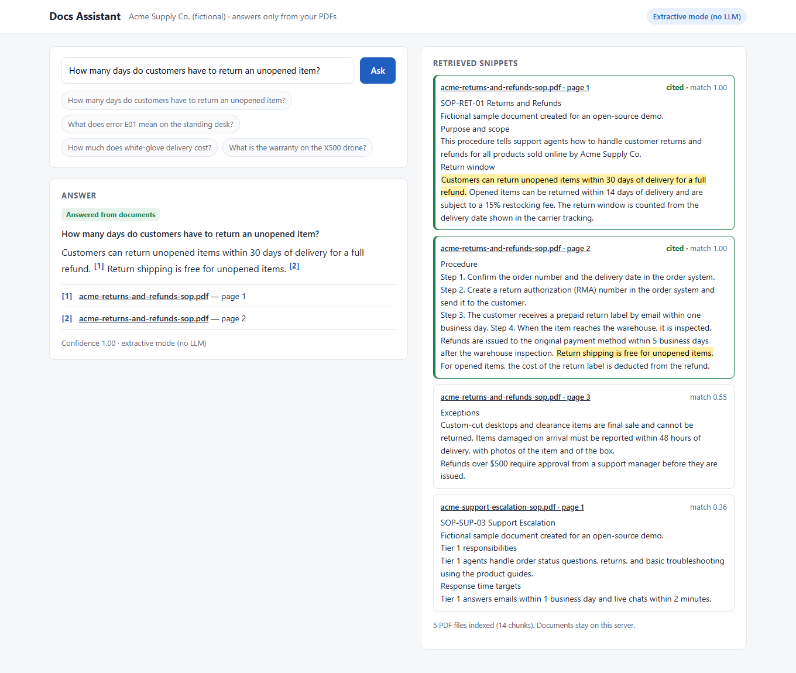
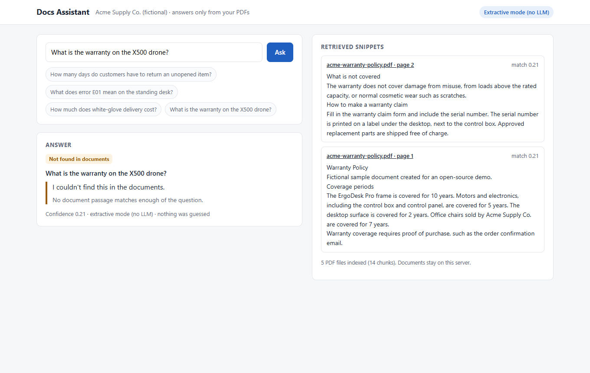

# PDF answers with citations

**A common request on freelance job boards:** a support team keeps answering the same questions and wants an AI chatbot that answers accurately from its own documents, not generic AI answers.

Open-source demo: a small Python service that answers questions from a folder of PDFs, shows the **document name and page** for every answer, and says **"I couldn't find this in the documents."** instead of guessing. The sample PDFs are about a fictional company, Acme Supply Co.

## What it does

- Reads every PDF in a folder and keeps the **file name and page number** on every chunk of text.
- `/chat` API (FastAPI) and a small web page: the answer, clickable citations that open the PDF **at the cited page**, and the retrieved snippets with the quoted sentence highlighted.
- **Refuses** when retrieval confidence is low or the answer cannot be tied to a retrieved passage. No model is called for a refused question.
- **Validates every citation** against the index before it is shown: the chunk exists, file and page match, and the quoted text is really in that chunk.
- Runs **fully offline by default** (extractive mode, no LLM, no API key). OpenAI, Anthropic Claude, Google Gemini or a local Ollama model can be switched on with environment variables (provider, model and API key).
- One command runs an **evaluation** on sample questions (including questions the documents cannot answer) and prints a markdown table.

| Answer with citations | Out-of-scope question |
|---|---|
|  |  |

Both screenshots were taken in **extractive mode (no LLM)**, the default, by `python scripts/screenshots.py`. The answer text is the documents' own sentences; no model wrote it.

## Architecture

```mermaid
flowchart LR
    subgraph Ingestion["Ingestion (at startup)"]
        PDF[PDF folder] --> Pages["pypdf: one Document per page<br/>metadata: file, page"]
        Pages --> Split["LangChain text splitter<br/>chunks never cross a page"]
        Split --> Index["BM25 index + word rarity (IDF)"]
    end

    Q[Question] --> API["FastAPI /chat"]
    API --> Ret["LangChain retriever<br/>top-k chunks + confidence"]
    Index --> Ret
    Ret --> Gate{"confidence ≥<br/>MIN_CONFIDENCE?"}
    Gate -- no --> Refuse["I couldn't find this<br/>in the documents."]
    Gate -- yes --> Mode{LLM_PROVIDER}
    Mode -- none --> Ext["Extractive answer<br/>best sentences + [n]"]
    Mode -- "openai / anthropic /<br/>gemini / ollama" --> LLM["LLM sees only the snippets<br/>must cite [S1], [S2]..."]
    LLM --> Ground["Grounding check<br/>citations, numbers, words"]
    Ground -- fails --> Refuse
    Ext --> Val["Citation validation<br/>chunk, file, page, quote"]
    Ground -- passes --> Val
    Val -- fails --> Refuse
    Val -- passes --> Out["Answer + citations<br/>+ snippets"]
```



Code map: `pdfrag/ingest.py` (PDF to page chunks), `pdfrag/retriever.py` (BM25 and confidence), `pdfrag/answer.py` (extractive and LLM answers, grounding, citation validation), `pdfrag/llm.py` (provider switch), `pdfrag/api.py` (API and PDF links), `pdfrag/static/index.html` (UI), `pdfrag/evaluate.py` (evaluation).

## Quick start

With Docker (one command), then open http://localhost:8000:

```bash
docker compose up --build
```

Without Docker (Python 3.11+):

```bash
python -m venv .venv
.venv/bin/pip install -r requirements.txt     # Windows: .venv\Scripts\pip install -r requirements.txt
.venv/bin/python -m pdfrag                    # Windows: .venv\Scripts\python -m pdfrag
```

**Use your own PDFs:** with Docker, `PDF_FOLDER=/path/to/pdfs docker compose up --build` (mounted read-only). Without Docker, set `DOCS_DIR=/path/to/pdfs`.

**Switch on an LLM:** copy `.env.example` to `.env`, set `LLM_PROVIDER` (`openai`, `anthropic`, `gemini` or `ollama`), `LLM_MODEL` and the matching API key, then install `requirements-llm.txt` (with Docker, set `WITH_LLM=1` in `.env`).

**API:**

```bash
curl -s localhost:8000/chat -H "Content-Type: application/json" \
     -d '{"question": "How much does white-glove delivery cost?"}'
```

The response has `answer`, `refused`, `reason`, `confidence`, `citations` (`source`, `page`, `quote`, `url`) and `snippets`. Interactive API docs are at `/docs`.

### Tests and evaluation

```bash
.venv/bin/pip install -r requirements-dev.txt
.venv/bin/python -m pytest                       # ingestion metadata, refusals, citation validation, LLM guardrails, API
.venv/bin/python -m pdfrag.evaluate --write      # evaluation report -> docs/eval-results.md
.venv/bin/python -m pdfrag.evaluate --sweep      # answered vs refused for several MIN_CONFIDENCE values
```

The LLM-mode tests use LangChain's fake chat model, so they run offline and check what happens when a model cites a passage that was not retrieved, invents a number, adds an uncited sentence, or fails.

## Evaluation on the sample questions

`eval/questions.yaml` has answerable questions (with the expected file and page, and a key fact the answer must contain) and questions the documents do not answer (the bot must refuse). Results in extractive mode, reproduced by `python -m pdfrag.evaluate --update-readme`:

<!-- eval:start -->
Mode: **extractive mode (no LLM)** · top_k=4 · MIN_CONFIDENCE=0.5 · 19 questions in `eval/questions.yaml`

| Metric | What it measures | Result |
|---|---|---|
| Retrieval hit rate | Answerable questions where the expected page is in the top-4 snippets | 14/14 (100%) |
| Answered | Answerable questions the bot answered instead of refusing | 12/14 (86%) |
| Citation correctness | Answers that cite the expected document and page | 12/12 (100%) |
| Key fact present | Answers that contain the expected fact (e.g. "30 days") | 11/12 (92%) |
| Correct refusal rate | Unanswerable questions where the bot said it could not find the answer | 5/5 (100%) |
<!-- eval:end -->

Per-question results, including the misses, are in [docs/eval-results.md](docs/eval-results.md). What the misses show:

- Two answerable questions are **refused** because they use words the documents never use ("maximum *weight* the desk can *carry*" vs. "load capacity"; "order *total* that *qualifies*"). Keyword search cannot match synonyms, and the bot refuses rather than guess. An LLM provider does not change this, because retrieval runs first; the usual fix is adding semantic (embedding) search, which is not included here (see *Adapting this to your stack*).
- One answer cites the right page but picks the wrong sentence ("warranty on the desk motors": it returns general warranty sentences instead of "Motors and electronics ... are covered for 5 years"). Extractive mode ranks sentences by word overlap only. An LLM reading the same snippets is expected to do better here, but that was not measured (no API key was used).
- The questions were written together with the documents, and `MIN_CONFIDENCE`, the stemming and the stopword list were adjusted while looking at this same small set. Treat the table as a demonstration of the method, not as a promise for your documents. With your 15–20 questions, the same command gives you the numbers for your corpus.

**RAGAS:** each answerable question has a `reference` answer, so the file can be fed to RAGAS or another LLM-judged evaluation. RAGAS itself is not included: it needs an LLM judge and an API key, and this demo runs without one.

## How it fails safely

- **Low confidence, no answer.** Confidence is the share of the question's informative words found in the best passage, weighted by how rare each word is. A word the documents never mention ("X500 drone", "cryptocurrency", "CEO") weighs the most, so the question gets low confidence even when common words like "warranty" match. Below `MIN_CONFIDENCE` the bot answers "I couldn't find this in the documents." and no model is called.
- **Names count once.** "Acme Supply Co." is one concept, not three matching words, so a question about the company that the documents do not answer is still refused.
- **Extractive mode only quotes.** The answer is made of sentences copied from the passages, each with its citation. Nothing is paraphrased, so nothing can be invented. If no sentence covers enough of the question, it refuses.
- **LLM mode is checked before it is shown.** The model sees only the retrieved snippets, numbered `[S1]...[Sk]`, and must cite one after every statement or reply `NOT_FOUND`. Then the code refuses the answer if: it says `NOT_FOUND`; it has no citations; it cites a snippet number that was not given; a statement has no citation; a number in a statement (price, days, percentage) does not appear in the cited snippet; or most of a statement's words are not in the cited snippet.
- **Every citation is validated** against the index (real chunk, same file and page, quoted text present). A failed check turns the answer into a refusal.
- **Errors are not dressed up as answers.** If the LLM call fails, the user sees "The answer could not be generated right now. Nothing was guessed." A PDF that cannot be read is skipped and logged; the other files still load.
- **The refusal reason is visible** in the API (`reason`, `reason_text`) and in the UI, so you can see why a question was refused and tune the threshold.

## Privacy: your documents stay with you

- PDFs are read and indexed **locally**, in memory. There is no vector database service and no upload.
- In the default extractive mode **nothing leaves the machine**: no model, no API key, no network call.
- When an LLM provider is switched on, **only the question and the top-k retrieved snippets** (by default 4 passages of up to about 600 characters) are sent to the provider for that question. Whole documents are never sent.
- For **fully local** use, set `LLM_PROVIDER=ollama` and run the model on your own machine or server.
- The PDF links in the UI only serve files that were indexed, looked up by name (never as a path), so the API cannot be used to read other files. Docker mounts the PDF folder read-only and the app runs as a non-root user.
- The web page has **no login**. Run it on an internal network or behind your existing single sign-on.

## Design decisions and trade-offs

- **BM25 keyword search instead of embeddings.** It runs offline, needs no model download, is fast for a few hundred PDFs and its confidence is easy to explain. The cost is synonyms (see the evaluation). For a real deployment I would add embeddings next to BM25 (hybrid search) and keep the same refusal and citation checks.
- **Confidence from query coverage, not from the BM25 score.** BM25 scores are not comparable between questions, so they make a poor threshold. Coverage is between 0 and 1 and means the same thing for every question.
- **LangChain where it helps, not everywhere.** Documents, the text splitter, the retriever interface, prompt templates and the chat-model interface come from LangChain (that is what makes four providers one setting). PDF loading uses `pypdf` directly and the grounding checks are plain Python, so the safety logic is short, readable and tested without a model.
- **Page-level chunks.** Each page is split on its own, so a citation always points to one page. Repeated headers and footers are removed before splitting.
- **Strict LLM checks.** Requiring a citation after every statement and matching numbers will sometimes refuse a correct answer that a model phrased loosely. For a support team that was told "no guessing", a refusal is cheaper than a wrong refund policy.
- **No database.** The index is rebuilt at startup in a few seconds for a corpus of this size. For thousands of PDFs, persist the index.

## Limits

- **No real LLM provider was called.** There is no API key on the machine this was built on. LLM mode is tested with a fake model, and the OpenAI, Anthropic, Gemini and Ollama classes are only checked to build with a dummy key. Prompt wording may need tuning per model.
- **Keyword retrieval** misses paraphrases and synonyms (two of the sample questions). No embedding search is included.
- **Scanned PDFs** (images without a text layer) are not supported; they are logged and skipped. OCR is not included.
- **Tables and multi-column layouts** are extracted as plain text, which can mix up columns.
- English only (stemming and the stopword list are English).
- A question that mixes a covered topic with something the documents never mention can still pass the threshold and get the general answer. For example, "How much does expedited shipping to Canada cost?" returns the expedited shipping price, while the documents say they ship to the United States only. An LLM reading the snippets is more likely to notice this, but that was not measured.
- Tested on the five small fictional PDFs in `sample_docs/`, not on a real 80-document corpus.
- No authentication, rate limiting or chat history. Each question is answered on its own.
- The index is in memory; adding or changing PDFs needs a restart.

## Adapting this to your stack

- **Your documents:** point `DOCS_DIR` (or `PDF_FOLDER` with Docker) at the folder. Nothing else changes.
- **Your evaluation:** replace `eval/questions.yaml` with your 15–20 questions (expected file and page, a key fact, and a few questions the documents should not answer), then run `python -m pdfrag.evaluate --sweep` to pick `MIN_CONFIDENCE` for your documents.
- **OpenAI** (the stack in the brief): `LLM_PROVIDER=openai`, `LLM_MODEL=<your model>`, `OPENAI_API_KEY=...`. The same grounding checks apply.
- **Better recall:** add an embedding retriever (for example OpenAI embeddings or a local model) next to `BM25PageRetriever`, merge the two result lists (hybrid search), and keep `answer.py` as it is.
- **Where people ask:** the `/chat` endpoint can sit behind a help-desk widget, Slack or Teams bot; the response already carries the citations to show.
- **Other file types:** add a loader in `pdfrag/ingest.py` that returns one Document per page or section with `source` and `page` metadata.

## License

MIT. See [LICENSE](LICENSE).
